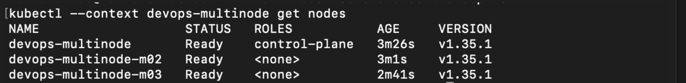
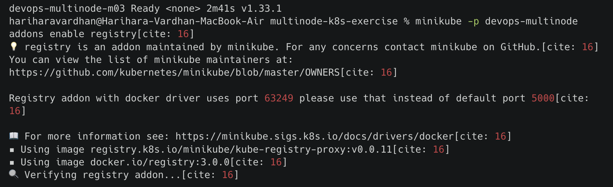
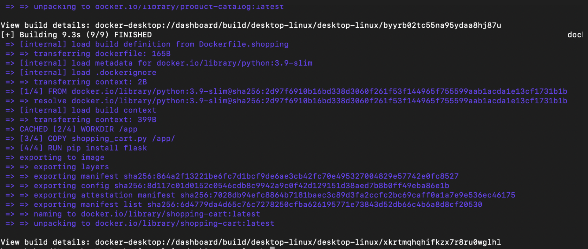
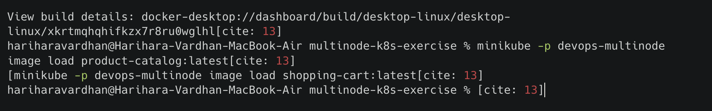
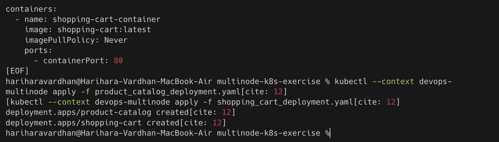
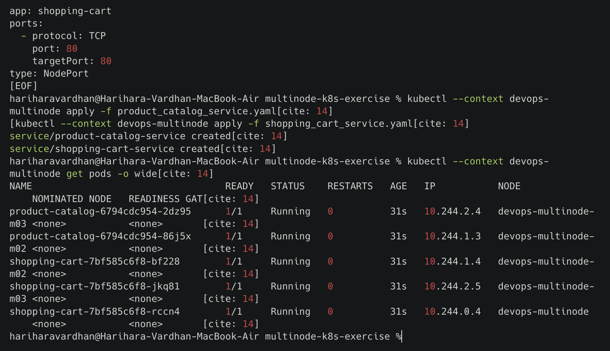
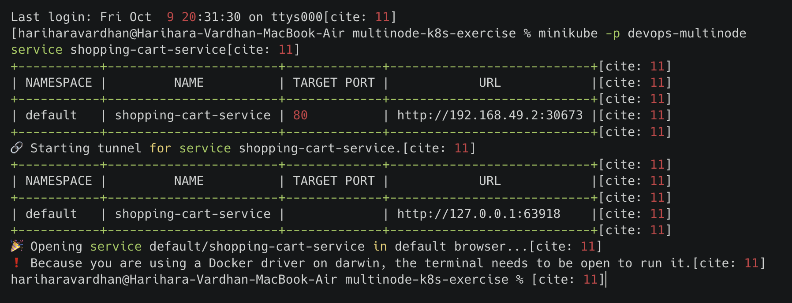
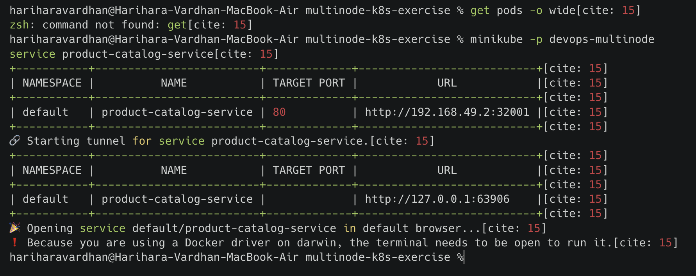
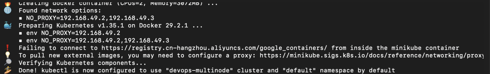

# Exercise 10: Multi-Node Kubernetes Cluster with Multiple Applications and ReplicaSets

## Storyboard
Building an e-commerce platform with two services:
1. **Product Catalog** (AppA) — provides information about available products
2. **Shopping Cart** (AppB) — manages user shopping carts

For availability and fault tolerance, Product Catalog runs 2 replicas and Shopping Cart runs 3 replicas, with pod anti-affinity rules ensuring each replica lands on a different node.

## Use Case
An online store needs high availability for critical services like product browsing and cart management. Distributing replicas across multiple nodes means that even if one node fails, the services remain available to customers.

## Step 1: Clean up and start a 3-node Minikube cluster

```bash
minikube stop
minikube delete
minikube start --nodes 3 -p devops-multinode
```


> **Note:** The original exercise includes a `--force` flag intended for running Minikube as root on Linux. This wasn't needed on macOS and was omitted.

### Platform issue: registry.k8s.io connectivity block

The cluster start hit the same `registry.k8s.io` connectivity block seen in earlier exercises. Re-running with the image mirror flag worked around it:

```bash
minikube delete -p devops-multinode
minikube start --nodes 3 -p devops-multinode --image-mirror-country=cn
```

### Platform issue: worker nodes briefly NotReady

After the cluster finished starting, the two worker nodes showed `NotReady`:

```bash
kubectl --context devops-multinode get nodes
```

devops-multinode Ready control-plane
devops-multinode-m02 NotReady <none>
devops-multinode-m03 NotReady <none>


`kubectl describe node` showed the cause: `container runtime network not ready: NetworkPluginNotReady message:docker: network plugin is not ready: cni config uninitialized`. This resolved itself after waiting roughly 45 additional seconds for the CNI plugin (`kindnet`) to finish initializing on each node — not an error, just a timing dependency on a resource-constrained local multi-node cluster.

```bash
kubectl --context devops-multinode get nodes
```



## Step 2: Enable the registry addon

```bash
minikube -p devops-multinode addons enable registry
```



### Finding: registry-proxy ImagePullBackOff is a non-blocker

Two of the three `registry-proxy` pods (one per node) got stuck in `ImagePullBackOff`, unable to reach `registry.k8s.io` for the `kube-registry-proxy` image:

```bash
kubectl --context devops-multinode get pods -n kube-system | grep registry
```

registry-7984dc5f99-92pgd 1/1 Running
registry-proxy-hw2h6 0/1 ImagePullBackOff
registry-proxy-n7w7z 1/1 Running
registry-proxy-tg5cn 0/1 ImagePullBackOff


This did **not** block the exercise: `minikube image load` pushes images directly into each node's local Docker daemon, independent of the registry-proxy addon. The addon issue was left unresolved as a documented platform limitation, and the exercise proceeded successfully regardless.

## Step 3: Product Catalog (AppA) — Flask app

`product_catalog.py`
```python
from flask import Flask, jsonify

app = Flask(__name__)

products = [
    {"id": 1, "name": "Laptop", "price": 1200},
    {"id": 2, "name": "Phone", "price": 800},
    {"id": 3, "name": "Headphones", "price": 150},
]

@app.route("/products", methods=["GET"])
def get_products():
    return jsonify(products)

if __name__ == "__main__":
    app.run(host="0.0.0.0", port=80)
```

## Step 4: Shopping Cart (AppB) — Flask app

`shopping_cart.py`
```python
from flask import Flask, jsonify, request

app = Flask(__name__)

cart = []

@app.route("/cart", methods=["GET"])
def get_cart():
    return jsonify(cart)

@app.route("/cart", methods=["POST"])
def add_to_cart():
    item = request.json
    cart.append(item)
    return jsonify(cart), 201

if __name__ == "__main__":
    app.run(host="0.0.0.0", port=80)
```

## Step 5: Dockerize both applications

`Dockerfile.product`
```dockerfile
FROM python:3.9-slim
WORKDIR /app
COPY product_catalog.py /app/
RUN pip install flask
CMD ["python", "product_catalog.py"]
```

`Dockerfile.shopping`
```dockerfile
FROM python:3.9-slim
WORKDIR /app
COPY shopping_cart.py /app/
RUN pip install flask
CMD ["python", "shopping_cart.py"]
```

```bash
docker build -t product-catalog:latest -f Dockerfile.product .
docker build -t shopping-cart:latest -f Dockerfile.shopping .
```



## Step 6: Load images into the cluster

```bash
minikube -p devops-multinode image load product-catalog:latest
minikube -p devops-multinode image load shopping-cart:latest
```

```bash
minikube -p devops-multinode ssh -- docker images | grep -E "product-catalog|shopping-cart"
```



## Step 7: Deploy with pod anti-affinity

`product_catalog_deployment.yaml` — 2 replicas, required anti-affinity on `app: product-catalog`
`shopping_cart_deployment.yaml` — 3 replicas, required anti-affinity on `app: shopping-cart`

Both deployments use `requiredDuringSchedulingIgnoredDuringExecution` pod anti-affinity with `topologyKey: "kubernetes.io/hostname"`, which forces the Kubernetes scheduler to place replicas of the same app on different nodes rather than allowing it as a soft preference.

> **Bug fixed from the original exercise:** the original `shopping_cart_deployment.yaml` specified `namespace: devops-exercise`, while `product_catalog_deployment.yaml` used `namespace: default` — and no `devops-exercise` namespace was ever created in the exercise. This mismatch would cause the Shopping Cart deployment to fail. Both manifests were set to `namespace: default` for consistency.

```bash
kubectl --context devops-multinode apply -f product_catalog_deployment.yaml
kubectl --context devops-multinode apply -f shopping_cart_deployment.yaml
```



## Step 8: Expose both services

`product_catalog_service.yaml` and `shopping_cart_service.yaml` — both `NodePort` services on port 80.

```bash
kubectl --context devops-multinode apply -f product_catalog_service.yaml
kubectl --context devops-multinode apply -f shopping_cart_service.yaml
```

## Step 9: Verify pod distribution across nodes

```bash
kubectl --context devops-multinode get pods -o wide
```



Result confirmed the anti-affinity rules worked as intended:
- **Product Catalog** (2 pods): one on `devops-multinode-m02`, one on `devops-multinode-m03`
- **Shopping Cart** (3 pods): one on `devops-multinode-m02`, one on `devops-multinode-m03`, one on the control-plane node `devops-multinode`

No two replicas of the same service share a node.

## Step 10: Access and test both services

```bash
minikube -p devops-multinode service shopping-cart-service
```


```bash
minikube -p devops-multinode service product-catalog-service
```


### Test Product Catalog
```bash
curl http://127.0.0.1:63963/products
```
```json
[{"id":1,"name":"Laptop","price":1200},{"id":2,"name":"Phone","price":800},{"id":3,"name":"Headphones","price":150}]
```

### Test Shopping Cart
```bash
curl http://127.0.0.1:63945/cart
```
```json
[]
```

```bash
curl -X POST http://127.0.0.1:63945/cart -H "Content-Type: application/json" -d '{"id": 1, "name": "Laptop", "quantity": 1}'
```
```json
[{"id":1,"name":"Laptop","quantity":1}]
```



## Summary
Deployed two Python Flask applications on a 3-node Minikube cluster with ReplicaSets, using pod anti-affinity to guarantee each replica runs on a distinct node. This maximizes availability and fault tolerance: a single node failure would not take down an entire service, since replicas are deliberately spread across the cluster.

## Key Takeaways
- `requiredDuringSchedulingIgnoredDuringExecution` pod anti-affinity is a hard constraint — the scheduler will leave a pod `Pending` rather than violate it, unlike the `preferred` variant which is a soft hint.
- A multi-node local cluster has more moving parts than single-node: worker nodes can briefly report `NotReady` while CNI networking initializes, which is normal and resolves on its own given a little time.
- `minikube image load` is independent of the registry addon — a broken or partially-working registry-proxy doesn't block getting locally-built images onto cluster nodes.
- Namespace consistency across related manifests matters: a mismatched `namespace` field between a Deployment and its dependencies is a common, easy-to-miss source of deployment failures.
